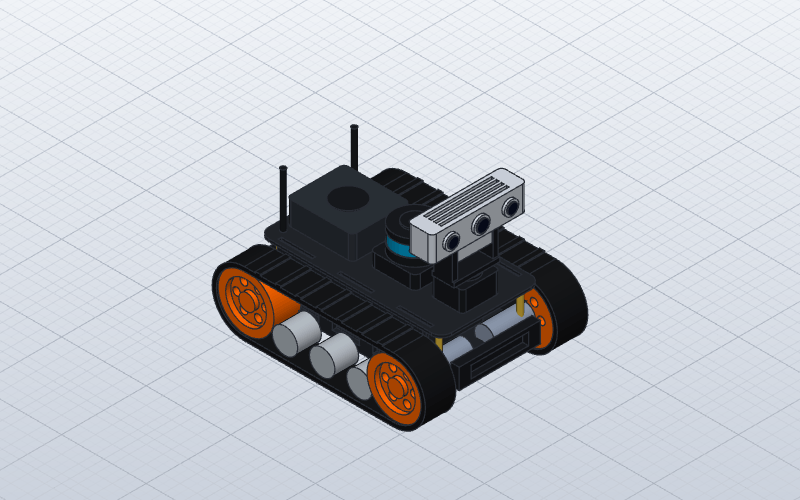
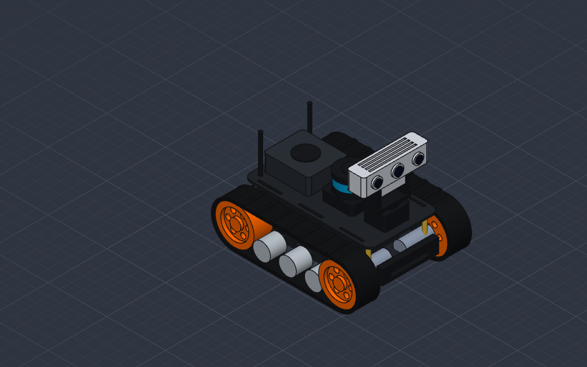
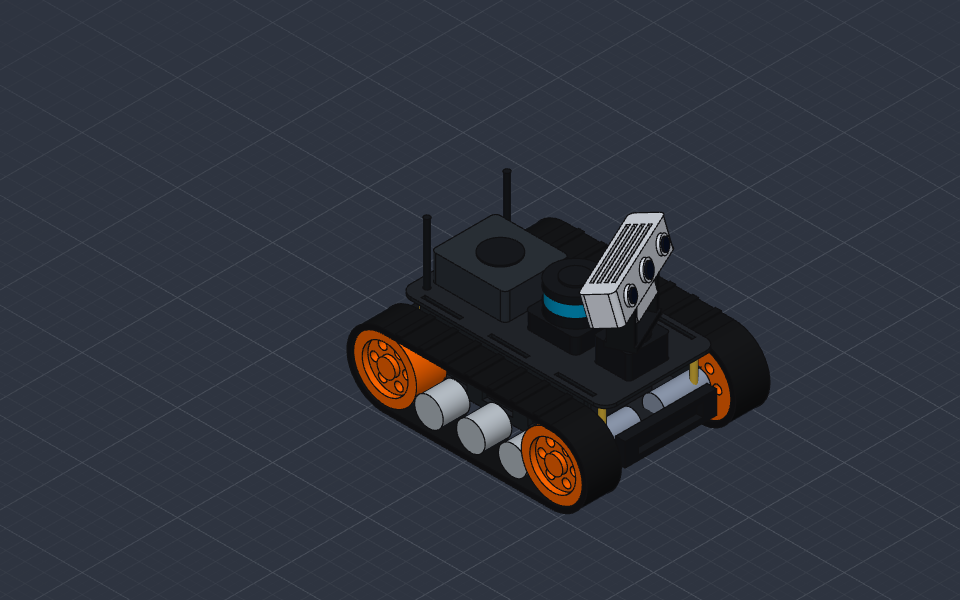
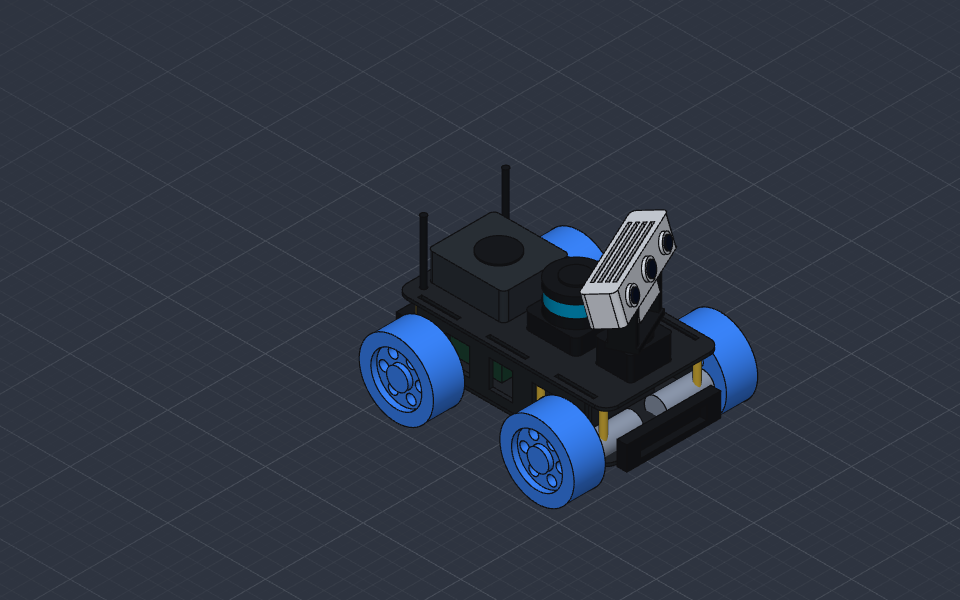

# 🤖 Centre de Simulation Robotique 3D : Hiwonder MentorPi & Hexapode 18-DOF

Suite de simulation robotique interactive sous **PyBullet** (avec interfaces de commande **Tkinter**, **LiDAR 360°**, **Caméra 3D RGB-D** et fichiers CAO **SolidCraft / URDF / STEP / Isaac Sim**).

<p align="center">
  
  
</p>

---

## ✨ Deux Robots Complets dans un Seul Lanceur

Le menu principal ([`sim_launcher.py`](sim_launcher.py) / [`run_pybullet.bat`](run_pybullet.bat)) permet de lancer et de basculer à tout moment entre :

### 1. 🤖 Hiwonder MentorPi (ROS2 / Raspberry Pi 5)
- **Modèle CAO SolidCraft 100 % Manifold** (`mentorpi_solidcraft/mentorpi.sc`, `.step`, `.urdf`) :
  - Boîtier **Raspberry Pi 5** ventilé + double antenne WiFi, carte contrôleur **RRC Expansion Board** (PCB vert), batterie LiPo 2S, entretoises hexagonales en laiton et 4 moteurs DC internes.
- **Double Châssis Interchangeable en Temps Réel** :
  - **🚜 Mode T1 (Chenilles Tank)** : Galets internes, barbotins et chenilles tout-terrain (pilotage différentiel skid-steer).
  - **🛞 Mode M1 (4 Roues Mecanum)** : Cinématique inverse omnidirectionnelle holonome ($V_x, V_y, \omega_z$ + déplacement latéral en crabe).
- **📡 LiDAR 360° ToF (STL27L / LD19)** :
  - Tourelle rotative avec fenêtre optique laser cyan, **Radar Polaire 2D** en direct, faisceaux laser 3D et **Exploration Autonome avec Évitement d'Obstacles**.
- **📷 Caméra 3D Depth sur Tourelle Pan-Tilt (2-DOF)** :
  - Asservissement des 2 servomoteurs Pan (`[-90°, +90°]`) et Tilt (`[-45°, +60°]`) + mode balayage automatique (`Scan_Demo`).
  - Retour vidéo embarqué en temps réel : **Flux RGB Couleur** et **Carte de Profondeur 3D Thermique (Depth)** avec télémètre central.

<p align="center">
  
  
</p>

---

### 2. 🕷️ Robot Hexapode 18-DOF (Dynamixel AX-18)
- **Cinématique Inverse (IK) 3-DOF Analytique** sur les 6 pattes ([`hexapod_kinematics.py`](hexapod_kinematics.py)).
- **Marche Tripode Omnidirectionnelle** ($V_x, V_y, \omega_z$) à profil cycloïde sans impact.
- **Contrôle d'Assiette 6-DOF** (Hauteur $Z$, Roulis, Tangage, Lacet) pieds ancrés au sol.
- **Saut Dynamique Explosif (`Jump`)**, postures prédéfinies (*Stand, Crouch, Rest*) et contrôle individuel des 18 servomoteurs Dynamixel AX-18.
- **Capteurs Embarqués** : Radar **LiDAR 360°**, **Caméra Frontale 3D (RGB & Depth)** et mode de **Marche Autonome d'Évitement d'Obstacles**.

---

## 🚀 Démarrage Rapide (Windows)

### En 1 clic
Double-cliquez sur [**`run_pybullet.bat`**](run_pybullet.bat).

### En ligne de commande
```powershell
pip install -r requirements.txt
python sim_launcher.py
```

Consultez également :
- 📖 [**Guide Complet PyBullet & Télécommandes (`PYBULLET_GUIDE.md`)**](PYBULLET_GUIDE.md)
- 📖 [**Guide ROS2 & Gazebo (`ROS2_GAZEBO_GUIDE.md`)**](ROS2_GAZEBO_GUIDE.md)
